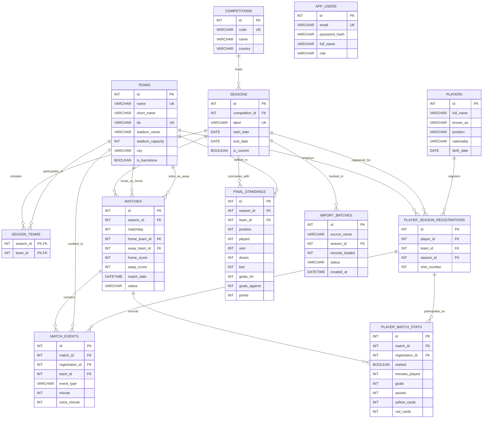

# Entity-Relationship (ER) Diagram & Relational Model

This document outlines the conceptual and physical Entity-Relationship model for the **FC Barcelona La Liga DBMS** database (`fcb_laliga_db`).

---

## 1. High-Level Entity Overview

The schema is structured into 12 normalized relational tables designed to support complete La Liga championship tracking with a primary analytical focus on FC Barcelona match performance, player metrics, and standings reconciliation:

1. **`competitions`**: Primary competition metadata (e.g. Primera División / La Liga).
2. **`seasons`**: Specific sporting campaigns (e.g. 2023-24, 2022-23).
3. **`teams`**: Registered football clubs, home stadiums, cities, and crest assets.
4. **`season_teams`**: Many-to-Many associative bridge allocating teams to seasons.
5. **`players`**: Footballers' biographical master records.
6. **`player_season_registrations`**: Squad registrations per club and season with squad shirt numbers.
7. **`matches`**: Fixture schedules, venues, matchdays, final scores, and completion statuses.
8. **`player_match_stats`**: Granular per-player appearance statistics (minutes, goals, assists, cards).
9. **`match_events`**: Chronological in-game occurrences (goals, bookings, substitutions).
10. **`final_standings`**: Historical official league tables used for audit reconciliation.
11. **`app_users`**: Role-based access control (RBAC) users with bcrypt password hashes.
12. **`import_batches`**: Audit trail and provenance logs for data ingestion pipelines.

---

## 2. Mermaid Entity-Relationship Diagram

---

## 3. Relational Cardinalities & Business Rules

1. **One-to-Many (`1:N`) Competition to Seasons**:
   - A single competition (La Liga) encompasses multiple historical and active seasons.
   - Deleting a competition is restricted if active seasons exist (`ON DELETE RESTRICT`).

2. **Many-to-Many (`M:N`) Seasons to Teams (`season_teams`)**:
   - In any season, exactly 20 teams participate in La Liga.
   - Teams move in and out of the top flight via annual promotion and relegation.
   - The composite primary key `(season_id, team_id)` prevents duplicate allocations.

3. **Many-to-Many (`M:N`) Players to Teams via `player_season_registrations`**:
   - Players transfer between clubs or sign season contracts.
   - A player can only be registered once per team and season: `UNIQUE (player_id, team_id, season_id)`.
   - Shirt numbers must be unique within a team in a given season: `UNIQUE (team_id, season_id, shirt_number)`.

4. **Self-Referencing Club Pairings in `matches`**:
   - Each match references two foreign keys to `teams`: `home_team_id` and `away_team_id`.
   - CHECK constraint enforces `home_team_id <> away_team_id`.
   - `UNIQUE (season_id, home_team_id, away_team_id)` prevents accidental double scheduling of identical home fixtures.

5. **Match Eligibility Integrity via Triggers**:
   - Before inserting or updating `player_match_stats`, trigger `trg_validate_player_match_team_insert` enforces that the participating player's registration belongs to either the `home_team_id` or `away_team_id` of that specific fixture.
